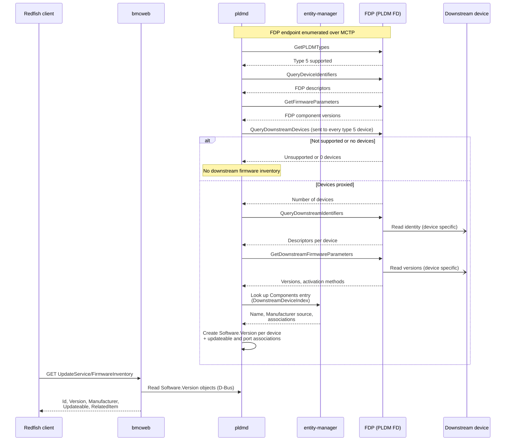
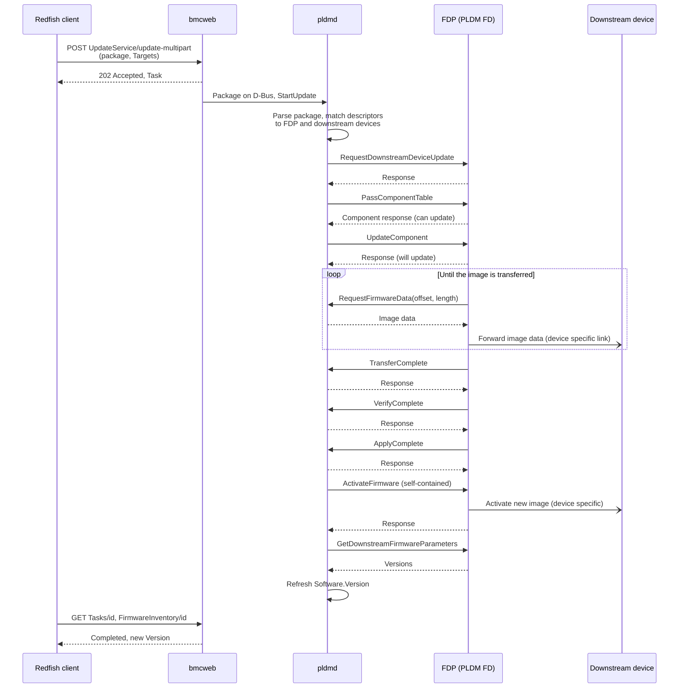

# PLDM Downstream Device Support

This document describes how pldmd discovers downstream devices, creates
their firmware inventory entries, and updates their firmware using the PLDM
for Firmware Update specification (DSP0267), version 1.3.0. The feature is
platform- and device-agnostic. Downstream device updates like optical
transceiver updates connected behind NICs are a typical example.

This guide explains the software prerequisites and entity-manager
configuration needed to discover downstream devices and create their
firmware inventory entries. It also describes how to build PLDM packages to
update their firmware.

## 1. Overview

A **Firmware Device Proxy (FDP)** is a PLDM firmware device that also
reports firmware information and manages updates for downstream devices. The
BMC, acting as the update agent, communicates with the FDP over MCTP, while
the FDP communicates with each downstream device over its supported
interface.

For optical transceiver updates, the NIC acts as the FDP, and the connected
optical transceivers are the downstream devices. The FDP must implement the
following PLDM Type 5 commands to support downstream firmware discovery and
updates.

| Command | Purpose |
|---|---|
| QueryDownstreamDevices | How many downstream devices the FDP proxies |
| QueryDownstreamIdentifiers | Descriptors (vendor, part number, ...) of each device |
| GetDownstreamFirmwareParameters | Per-device versions, components and supported activation methods |
| RequestDownstreamDeviceUpdate (0x20) | Puts the FDP in update mode for its downstream devices |
| PassComponentTable, UpdateComponent, ActivateFirmware | Same flow as for an FD |

### Firmware inventory

pldmd runs the usual QueryDeviceIdentifiers and GetFirmwareParameters on the
FDP, then the three downstream queries above. Each downstream device becomes
an `xyz.openbmc_project.Software.Version` D-Bus object, named
`<target>_DownstreamDevice_<index>` unless entity-manager sets a name
(section 3). With the `software_version/updateable` association, bmcweb
lists it under Redfish `UpdateService/FirmwareInventory` with
`Updateable: true`.

### Firmware inventory sequence



The FDP's own reads of the downstream devices are device specific and
outside PLDM. pldmd sends QueryDownstreamDevices to every firmware device
that supports PLDM type 5, whether or not it is an FDP. A device that does
not support the command answers with an unsupported-command error, and pldmd
then skips downstream firmware inventory for it.

### Redfish firmware inventory example

Firmware inventory (fields as served by bmcweb; the placeholders depend on the
device):

```
GET /redfish/v1/UpdateService/FirmwareInventory/Downstream_Device_0
{
  "@odata.id": "/redfish/v1/UpdateService/FirmwareInventory/Downstream_Device_0",
  "@odata.type": "#SoftwareInventory.v1_4_0.SoftwareInventory",
  "Id": "Downstream_Device_0",
  "Name": "Software Inventory",
  "Description": "Other image",
  "Manufacturer": "<name from the IEEE OUI>",
  "Version": "<version>",
  "Updateable": true,
  "SoftwareId": "<id>",
  "Status": {
    "Conditions": [],
    "Health": "OK",
    "State": "Enabled"
  },
  "RelatedItem": [
    {
      "@odata.id": "/redfish/v1/Chassis/FDP_0/NetworkAdapters/NIC_0/Ports/P0"
    },
    {
      "@odata.id": "/redfish/v1/Chassis/FDP_0/NetworkAdapters/NIC_0/Ports/P1"
    }
  ],
  "RelatedItem@odata.count": 2
}
```

### Update

A firmware package carries a *downstream device identification area*
(descriptors that select the target devices) and component images. pldmd
matches descriptors, sends RequestDownstreamDeviceUpdate, PassComponentTable
and UpdateComponent, transfers the image, verifies and applies it, then
activates. Packages for an FDP and for devices behind it are processed in
component image area order, one FDP job at a time, because an FD in update
mode cannot accept a second request.

To update all downstream devices, include package identification records
whose descriptors match every intended device and submit the package with
an empty Redfish `Targets` array (section 4). This selects matching devices
behind every discovered FDP, not just one FDP. Devices without a matching
record or a downstream firmware parameter-table entry are not updated.

Without explicit targets, pldmd groups devices behind the same FDP when
their complete descriptor sets and firmware parameter-table entries are
identical. A group with more than one device uses the all-matching-devices
selector (`ComponentClassificationIndex = 0xFF`) in PassComponentTable and
UpdateComponent; `ComponentIdentifier` carries a representative downstream
device index. Other devices use separate single-device jobs (`0x00`). There
is no separate update-all flag to set in the package metadata.

Activation uses the method the device supports. Devices that support only
self-contained activation are activated with that method, so no reset or
power cycle is requested. pldmd requests self-contained activation only when
the device advertises it in GetDownstreamFirmwareParameters and either the
package's `RequestedComponentActivationMethod` includes self-contained
activation (section 5) or the Redfish request sets `OperationApplyTime` to
`Immediate` (section 4). Without one of the two, the update is transferred
but self-contained activation is not requested. After activation pldmd re-reads
the downstream devices and the new version appears on D-Bus and Redfish. For
some devices the running version changes only after the device itself restarts;
check the device's documentation.

### Update sequence



The FDP-to-device link and how the FDP forwards the image are device
specific and outside PLDM. With several targets, pldmd repeats the
sequence per device and runs the jobs of one FDP one after another. Without
explicit targets, compatible devices can instead share the all-matching
sequence described above.

## 2. What to pick up

* **pldm**: `develop` at or after the commits in section 7.
* **libpldm**: a version with the downstream device encode/decode API and
  the decode of the 4-byte RequestDownstreamDeviceUpdate response.
* **entity-manager**: the `PLDMFirmwareDevice` schema with the downstream
  properties used in section 3 (`DownstreamDeviceIndex`,
  `ManufacturerNameSource`, `Manufacturer`, `Association*`).
* **MCTP**: the FDP must be enumerated as an MCTP endpoint that advertises
  PLDM type 5, with the `configured_by` association to its entity-manager
  record (for example with mctpd and mctpreactor).
* **Platform entity-manager configuration**: section 3.

## 3. Entity-manager configuration

Add one `Components` entry per downstream device to the FDP's
`PLDMFirmwareDevice` record. Use `ComponentIdentifier` 65535 (0xFFFF) for
downstream entries.

```json
{
    "Name": "FDP_0_PLDM",
    "Type": "PLDMFirmwareDevice",
    "MCTPTargetName": "FDP_0",
    "Components": [
        {
            "ComponentIdentifier": 65535,
            "DownstreamDeviceIndex": 0,
            "Name": "Downstream_Device_0",
            "ManufacturerNameSource": "IEEE_OUI",
            "AssociationForward": ["inventory", "inventory"],
            "AssociationBackward": ["activation", "activation"],
            "AssociationEndpoint": [
                "/xyz/openbmc_project/inventory/system/chassis/FDP_0/Ports/P0",
                "/xyz/openbmc_project/inventory/system/chassis/FDP_0/Ports/P1"
            ]
        }
    ]
}
```

| Property | Meaning |
|---|---|
| `DownstreamDeviceIndex` | Index the FDP reports for the device. A downstream entry without it is skipped with an error log. |
| `Name` | Firmware inventory object name; the Redfish `Id` |
| `ManufacturerNameSource` | Descriptor used for Redfish `Manufacturer` (see below) |
| `Manufacturer` | Fixed manufacturer name, used only when no `ManufacturerNameSource` is set |
| `Association*` | Relate the device to related items (for example ports, shown as `RelatedItem`) |

`ManufacturerNameSource` values: `IEEE_OUI` maps the IEEE Assigned Company
ID descriptor to a company name (an unknown OUI is shown as a hex string);
`VendorPN` uses the VendorPN descriptor, which is a part number rather than
a manufacturer. Devices with no entry keep the default name.

## 4. Redfish updates

Update with a multipart request. `Targets` lists the firmware inventory URIs to
update. For one device:

```bash
curl -k -u <user>:<pass> -X POST \
  https://<bmc>/redfish/v1/UpdateService/update-multipart \
  -F 'UpdateParameters={"Targets":["/redfish/v1/UpdateService/FirmwareInventory/Downstream_Device_0"],"ForceUpdate":true,"OperationApplyTime":"Immediate"};type=application/json' \
  -F 'UpdateFile=@package.fwpkg;type=application/octet-stream'

# the 202 response names a task; poll it
curl -k -u <user>:<pass> https://<bmc>/redfish/v1/TaskService/Tasks/<id>
```

To update all devices whose descriptors match the package, use an empty
`Targets` array:

```bash
curl -k -u <user>:<pass> -X POST \
  https://<bmc>/redfish/v1/UpdateService/update-multipart \
  -F 'UpdateParameters={"Targets":[],"ForceUpdate":true,"OperationApplyTime":"Immediate"};type=application/json' \
  -F 'UpdateFile=@package.fwpkg;type=application/octet-stream'
```

For a downstream-only update, leave `FirmwareDeviceIdentificationArea`
empty and include the appropriate `DownstreamDeviceIdentificationArea`
records (section 5). Empty `Targets` does not restrict the update to a
particular FDP. To update all downstream devices of just one FDP, explicitly
list every intended downstream device's firmware inventory URI in `Targets`.
Explicit targets always use separate single-device jobs, even when the
selected devices have identical descriptors.

Set `OperationApplyTime` to `Immediate` for devices that support only
self-contained activation.

The update is done when `TaskState` is `Completed` and `TaskStatus` is `OK`.
Task messages name the device. Then check `Version` in FirmwareInventory.

## 5. PLDM package

A firmware package for downstream devices is a standard PLDM firmware
package whose *downstream device identification area* selects the devices
and whose component image area carries the images.

### Package layout

The package header holds the package header information, the firmware
device and downstream device ID records with their descriptors, and the
component image information, followed by the header and payload checksums.
The payload holds the component images. The areas map to the package JSON as
follows:

| Package area | Role for downstream devices |
|---|---|
| `FirmwareDeviceIdentificationArea` | Selects FDs and FDPs. Empty for a package that only updates downstream devices. |
| `DownstreamDeviceIdentificationArea` | One record per device type: descriptors that must match the device's QueryDownstreamIdentifiers response, and the applicable components. |
| `ComponentImageInformationArea` | The images, with the component identifier, version string and `RequestedComponentActivationMethod`. |

### Downstream device identification area

Each record in `DownstreamDeviceIdentificationArea` has:

* `Descriptors`: the first descriptor is the device's IEEE Assigned Company
  ID (type 5) or SCSI Vendor ID. The rest can be any descriptors the device
  reports, for example vendor-defined descriptors (type 65535), each with a
  title and data in hex. The example below uses `VendorPN`, `VendorRev`,
  `HWMajor` and `FWMajor`, but the set is device specific. pldmd matches
  them against the descriptors the FDP reports for each device.
* `ApplicableComponents`: indexes into `ComponentImageInformationArea`
  that apply to the devices selected by this record.
* `DownstreamDeviceUpdateOptionFlags`: update options for this record.

In `ComponentImageInformationArea`, `RequestedComponentActivationMethod` of
`1` requests self-contained activation. See section 1 for how it combines
with the Redfish `OperationApplyTime`.

Example ([metadata-example-downstream-device.json](../tools/fw-update/metadata-example-downstream-device.json)):

```json
{
    "PackageHeaderInformation": {
        "PackageHeaderIdentifier": "7b291c996db64208801b02026e463c78",
        "PackageHeaderFormatVersion": 4,
        "PackageReleaseDateTime": "30/08/2026 00:00:00",
        "PackageVersionString": "NvXcvr-046.150.0055"
    },
    "FirmwareDeviceIdentificationArea": [],
    "DownstreamDeviceIdentificationArea": [
        {
            "DownstreamDeviceUpdateOptionFlags": [],
            "ApplicableComponents": [
                0
            ],
            "Descriptors": [
                {
                    "DescriptorType": 5,
                    "DescriptorData": "2db048"
                },
                {
                    "DescriptorType": 65535,
                    "VendorDefinedDescriptorTitleString": "VendorPN",
                    "VendorDefinedDescriptorData": "4d4d53345830302d4e53343030"
                },
                {
                    "DescriptorType": 65535,
                    "VendorDefinedDescriptorTitleString": "VendorRev",
                    "VendorDefinedDescriptorData": "4137"
                },
                {
                    "DescriptorType": 65535,
                    "VendorDefinedDescriptorTitleString": "HWMajor",
                    "VendorDefinedDescriptorData": "3635"
                },
                {
                    "DescriptorType": 65535,
                    "VendorDefinedDescriptorTitleString": "FWMajor",
                    "VendorDefinedDescriptorData": "3436"
                }
            ]
        }
    ],
    "ComponentImageInformationArea": [
        {
            "ComponentClassification": 65535,
            "ComponentIdentifier": 0,
            "ComponentOptions": [],
            "RequestedComponentActivationMethod": [
                1
            ],
            "ComponentVersionString": "046.150.0055",
            "ComponentComparisonStamp": "0xffffffff"
        }
    ]
}
```

### Tools

* Build with `tools/fw-update/pldm_fwup_pkg_creator.py` from a JSON like the
  example above.
* Inspect with `tools/fw-update/fwpkg_unpack.py --dump_builder_json`, which
  writes a builder JSON that `pldm_fwup_pkg_creator.py` can rebuild the
  package from.
* See `tools/fw-update/README.md` for the tool documentation.

## 6. Debugging with pldmtool

Optional. To confirm the FDP reports its devices before debugging firmware
inventory or Redfish, run (add `-m <EID>`):

```bash
pldmtool fw_update QueryDownstreamDevices -m <EID>
pldmtool fw_update QueryDownstreamIdentifiers -m <EID> --transfer_operation_flag 1
pldmtool fw_update GetDownstreamFirmwareParameters -m <EID>
```

See `pldmtool/README.md` for usage.

## 7. Implementation commits (historical reference)

This list records the commits used for initial integration and can be
removed once that reference is no longer needed. The current implementation
in [fw-update](../fw-update/) and [tools/fw-update](../tools/fw-update/)
is the source of truth for behavior. Inspect a listed commit with
`git show <hash>`.

| Commit | Change | Why |
|---|---|---|
| b1fa0c34 | fw-update: inventory downstream devices behind a Firmware Device Proxy | Puts each downstream device on D-Bus so Redfish lists it and its version |
| 078fdddb | fw-update: downstream device inventory and update flow | Package parsing, RequestDownstreamDeviceUpdate, component transfer and activation; per-target updates |
| 8381ff49 | fw-update: request self-contained activation if it's the only option | Lets devices that only support self-contained activation complete an update |
| 35ad1cc3 | fw-update: mark downstream device inventory as updateable | `Updateable: true` and use as a Redfish update target |
| a7e76201 | fw-update: refresh downstream versions after self-contained activation | Avoids leaving the old version on D-Bus after a successful update |
| 88d598f2 | fw-update: order FDP and downstream updates by component image area | Serialises jobs per FDP |
| bc61b158, d1ba64c2 | fw-update: address downstream update review; drop duplicate downstream completion | Use the libpldm response decode; report a failed request once |
| dc93551d | fw-update: name downstream devices from EM config | Device name, associations and manufacturer (section 3) |
| f27db5ce | fw-update: use IEEE OUI as downstream manufacturer | Map the IEEE company ID descriptor to a manufacturer name |
| 27f7d5e7 | fw-update: name downstream device in task messages | Redfish task messages identify the device |
| ade9314c | fw-update: parse and emit downstream device IDs | Package tooling (section 5) can unpack and build downstream packages |

Optional, for compliance testing and debugging only. None is needed for
firmware inventory or Redfish updates:

| Commit | Change | Why |
|---|---|---|
| df3a17cf, 8c274cbd, be5c6864, fac78de7 | pldmtool: add QueryDownstreamDevices, QueryDownstreamIdentifiers, GetDownstreamFirmwareParameters and RequestDownstreamDeviceUpdate fw_update commands | Send each downstream command from the command line |
| 2314048a | pldmtool: recognize IEEE Assigned Company ID/SCSI Vendor ID descriptors | These are valid first descriptors for downstream devices but not for FDs or FDPs, so pldmtool otherwise drops them |
